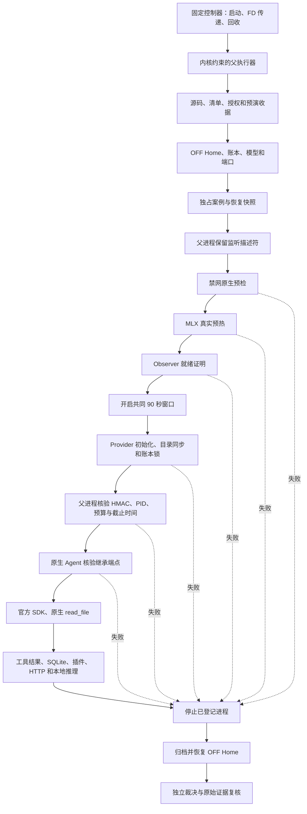

# H4E 运行路径验证与合成系统预演

基线：`40d49fc1dd480a4d77aa94a84193d52db1dd4054`。本文对应独立开发分支上的方法改造。开发中的局部通过不代表完整预演通过，任何合成结果均不构成真实 Provider 授权。

## 三次失败的共同问题

三次失败共同暴露了组件测试与实际运行环境之间的差距。测试验证了各个函数或组件的功能，却没有在同一条运行路径上同时验证进程拓扑、依赖解析、端口状态、操作系统权限及恢复过程。

| 冻结版本 | 触发条件 | 被遗漏的运行依赖 |
| --- | --- | --- |
| `0e3695b` | 父执行器 PATH 不包含安装的 Hermes CLI | 最终启动环境与依赖查找方式 |
| `a38a363` | 父进程已监听预算端口，预检发出元数据 GET 后等待响应 | 启动顺序、实际网络权限和服务就绪状态的交互 |
| `40d49fc` | 代理创建启动记录后退出 | 完整 CLI 初始化中的目录打开／同步，与文件权限之间的关系 |

第三个故障已使用实际代理 `main()`、实际策略构造函数、合成授权和临时账本完整复现。错误链是 `main → write_new_json → fsync_directory → os.open`，目录打开参数为 `O_RDONLY | O_DIRECTORY | O_NOFOLLOW`，内核返回 `PermissionError`、errno 1。启动 JSON 已创建，代理审计文件尚未创建。

最小修复只为 Provider 增加日志目录本身的 `file-read-data` literal 许可。未增加目录的递归读取或写入许可。实际内核反例确认：目录初始化可通过，未登记日志文件的内容仍不可读取；再次拒绝目录读取会重现原异常。历史第三次日志未保存完整异常链，所以该复现不能追溯证明其唯一根因。

## 真实执行路径

最终独立裁决在进程停止、运行后证据归档和状态恢复后完成，才能同时验证任务结果与恢复事实。任意失败不会进入下一个工作阶段。

## 各阶段的执行依赖

这里的 `ROOT` 为冻结仓库，`PRIVATE` 为本次唯一证据根，`CASE` 为缺失文件案例；`TEST_HOME` 为独立 OFF Home。合成预演镜像这些相对结构，并在明确的临时所有者目录中创建新数据。旧真实目录不参与写入。

| 阶段／执行进程 | 环境、解释器与 cwd | 输入、输出及必须的文件操作 | socket／FD | 权限和失败证据 | 停止与恢复 |
| --- | --- | --- | --- | --- | --- |
| 固定控制器 | 项目 Python；PATH=`/usr/bin:/bin`；cwd=`ROOT`；清除继承凭据和代理变量 | 冻结脚本、参数；保留同目录模块导入能力 | 无 Provider I/O | 实际启动导入测试；依赖缺失在启动阶段阻断 | 尚无服务或 Home 修改 |
| 父执行器准入 | 同一项目 Python；HOME 为所有者目录；cwd=`ROOT` | Git、完整发布清单、Hermes tar、授权、完整预演收据、依赖指纹 | 仅本地端口占用检查 | `admission.source`、`admission.authorization`、`admission.system_rehearsal` | 任何不符均不能创建案例 |
| Home 与账本检查 | 父执行器 | OFF 配置、插件、安装 facts、凭据元数据、模型摘要、历史账本与锁元数据 | bind 18782／18793／18794 后释放 | `admission.home`、`admission.budget`、`admission.ports` | 不读取真实凭据值；不预留请求 |
| 创建案例与快照 | 父执行器 | 独占创建 input、目标清单、prompt、随机密钥；文件 fsync 与目录 fsync；SQLite backup 与 quick_check | 父进程独占 18794 监听 FD | `case.create`、`home.checkpoint`、`provider.reserve_endpoint` | durable checkpoint 后才能切 Shadow；来源不明的恢复不得自动执行 |
| 原生预检 | Hermes venv Python；HOME 为所有者；HERMES_HOME=`TEST_HOME`；cwd=`CASE` | 冻结 Hermes、官方凭据解析、工具注册、真实 SQLite 写锁／rollback、AIAgent 构造；预检控制收据 | 禁止全部网络；父监听保持占用 | 实际 Seatbelt；`native.case/tools/credentials/sdk_guard/constructor` | 22 秒预检上限；失败即停止已登记组并恢复 |
| MLX 预热 | 项目 Python；HOME=`PRIVATE/service_home`；cwd 同；离线模型缓存变量 | 固定模型权重、配置、tokenizer、MLX／Metal 依赖；预热日志 flush/fsync | 监听 18782；无外部出口 | 实际 IOKit、Metal 权限；`mlx.load/warmup/ready` | 所属 PID／PGID／UID／启动时间核验后停止 |
| Observer | 项目 Python；service HOME/cwd | input 和关联密钥；HTTP 证据追加与 fsync | 监听 18793；仅连接 18782 | 就绪 HMAC 绑定 source SHA 和 PID；`observer.listen/ready` | 未通过身份核验不能启动 Provider |
| Provider 初始化 | 项目 Python；service HOME/cwd | 逐文件核验清单和授权；token 读取；启动 JSON 与日志目录同步；账本 `O_NOFOLLOW` 打开和非阻塞 flock | 继承 18794 监听 FD；真实出口固定 Step Plan，合成出口固定 18795 | `provider.source_authorization/startup_record/budget_lock_open/budget_lock_acquire/budget_ledger_open/listener_identity` | 初始化失败后父进程不得启动 native；不能等待忙锁或重试 |
| 父进程身份确认 | 父执行器 | 核验并落盘代理就绪证据 | 本地 `/_budget`；父进程继续保留 FD | HMAC、PID、源码、预算、deadline 必须全部匹配 | 代理提前退出、错误证明均阻断 |
| 原生 Agent | Hermes venv Python；原生 HOME/cwd | 在读取凭据前校验继承端点；官方 run_oneshot／AIAgent／OpenAI SDK；只有一次原生 read_file | 保留继承 FD；仅连接 18793／18794 | `native.endpoint_identity`、`native.task`；SDK 与工具次数独立记录 | deadline 和停止锁生效；无备用路由或自动重启 |
| 工具与 Shadow | 原生 Agent、Observer、MLX | 唯一缺失路径；原生 not_found；SQLite、插件 state/lock、两次 Completion 和一次规则 Retry；模型推理日志 | 固定本地三段链路 | 原生／插件／HTTP HMAC 对应；记录真实本地推理 | 任意工具或目标越界立即停止；Retry 仅建议 |
| 停止与恢复 | 父执行器 | 原进程账本；运行后 SQLite 和插件归档；恢复前配置和逻辑状态；凭据只核对元数据 | 停子进程后关闭父 FD；确认固定端口释放 | `recovery.stop/restore` | 身份不确定不发送信号，不在未知进程下恢复 |
| 独立裁决 | 独立只读进程 | 源码／授权／原始证据／账本／HMAC／控制收据；SQLite 使用临时副本，避免只读打开产生原始 sidecar | 不连接 Provider 或服务 | 对真实和合成证据分别限定 origin、上游类型；重算结果 | 结果缺失、来源错误、恢复不符均不能 GO |

## 主动检查的隐藏依赖

- `HOME` 与 `HERMES_HOME` 分别影响安装依赖和运行数据。原生解释器的 symlink 最终目标、uv 目录、安装 facts 的路径哈希、PATH 和模块查找方式必须记录。
- 原生沙箱要求源码位于所有者 `Projects` 目录下。新静态准入在任何 Home 或账本操作前检查这一约束，避免到原生启动时才失败。
- 日志文件写权限不包含父目录打开权限。文件、目录、SQLite、锁和 descriptor 操作分别验证；不能以文件写入成功推断目录同步成功。
- 模型加载需要权重之外的配置和 tokenizer 文件，也需要实际 Metal／IOKit 权限。合成目录保存相同模型字节，不能以跨出允许 blob 范围的符号链接绕开来源验证。
- 官方凭据解析可能访问可选全局 store；预演保留一个不可读的合成全局 store，以验证既有兼容边界。
- SQLite 的 `mode=ro` 仍可能创建 WAL／SHM；独立 H4E 裁决使用副本，业务内容恢复与物理摘要变化分开报告。
- 子进程真实启动前必须持久登记身份，只有收到 GO 才执行。继承监听 FD 在 native 生命周期内保持占用，不能只验证一次 HTTP 返回。
- Git 本地配置和 attributes 也可能触发外部过滤命令。快照复核在执行任何快照代码前验证完整源文件集合、拒绝额外可导入模块，并限定 Git 配置与属性文件；自报 manifest 摘要不能替代实际内容核验。

## 反例必须证明什么

每个场景使用新的临时所有者、Home、账本和案例。成功标签不足以通过准入；必须核对原始日志、进程、数据库和预算证据。

| 注入 | 必须发生的阻断 | 预算和恢复断言 |
| --- | --- | --- |
| 日志目录读取拒绝 | `evidence.directory_open`，PermissionError／EPERM | 无 native、无请求；所属进程停止，Home 恢复 |
| 预算端口占用 | `admission.ports`，EADDRINUSE | 不创建案例；已有监听者保持完整 |
| 代理提前退出 | provider 就绪失败 | native 不启动；无请求；归属明确的进程全部停止 |
| 继承描述符失效 | `native.endpoint_identity`，EBADF | 读取凭据及 SDK 调用前停止 |
| 临时账本忙锁 | `provider.budget_lock_acquire`，EWOULDBLOCK | 非阻塞失败；账本原字节不变 |
| 必需 input 缺失 | `provider.source_authorization`，ENOENT | 不生成可信就绪证明；无请求 |
| 预登记缺失目标意外出现 | `native.case` | 阻断工具执行，证据保留 |
| 上游合成 500 | 实际 SDK／代理失败路径 | 只消耗一次合成请求，不重试，恢复通过 |
| 伪造 PASS、遗漏差异、来源变化、原始证据改动 | 收据核验失败 | 不生成真实授权，不启动服务 |

## 平台限制与已批准控制器

实际 macOS 实验发现：已经应用 Seatbelt 的进程不能再应用另一份不同 profile；同一 profile 可以重复应用。父进程的额外禁网 profile 与各角色真实 profile 的组合会在 `sandbox_apply` 返回 EPERM。这说明只检查策略文本或先用同一 profile 验证嵌套，会得到不完整结论。

本轮没有采用 `with no-sandbox` 绕过。独立设计审查指出，允许通用 `/usr/bin/sandbox-exec` 退出父沙箱，无法限制其 profile 参数，也留下角色入口探针之前的权限缺口。

用户于 2026-10-30 明确接受固定控制器例外。控制器自身不应用 Seatbelt，仅处理固定角色的启动、监听描述符传递、身份登记、GO 和回收；它不读取 Provider 凭据、不调用模型、不发送外网请求。父执行器、fixture、五个执行角色和独立 verifier 分别应用自己的内核策略，因此无需嵌套不同 profile。控制器自身缺少内核禁外网保证，这一差异由机器清单明确保留。

匿名 socketpair 协议不接受任意命令、策略或路径。控制器重新构造固定命令，并与父执行器的计划摘要核对；完整消息有绝对期限，单个目标回收失败不会跳过其他目标。父执行器通过 macOS 的只读进程接口登记角色身份，避免依赖受限环境下不可执行的 setuid `ps`。查询权限不足时保留 UNKNOWN，禁止误判已停止或向不确定身份发送信号。

正式入口与合成执行器共用 `parent_policy`。该策略精确许可 18794 的 bind/listen、配置切换临时文件、恢复文件及案例目录，拒绝父执行器读取凭据值。端口检查使用 SO_REUSEADDR 排除正常 TIME_WAIT，同时保留活跃监听者冲突反例。就绪证明、控制器实际命令、内核禁网探针、角色库存、fixture 请求数和停止结果均由独立 verifier 核对。

组件测试和一次成功链路仅提供开发证据。完整故障矩阵、精确冻结源码、最终回归和独立审查的结果，以本次外部交付收据为准；缺少任何一项时维持 NO-GO。

## 准入与残余边界

完整预演通过后，`--check-offline` 还须核验精确冻结 SHA、完整发布清单、解释器／依赖／模型指纹、系统版本、完整反例矩阵、逐文件证据摘要及机器可读差异，再在禁网的独立进程中重算原生／HMAC／模型／恢复结果。源码或环境变化、收据过期、证据缺失、未声明差异一律阻断。

即使合成全链路通过，真实 DNS、TLS、StepFun 可用性、真实凭据有效性、远端模型行为和订阅扣费仍未验证。工程准入只允许进入独立审查与新授权流程，不能自动产生第四次真实 H4E。

## 退出确认与恢复门槛

首次冻结后的合成复验曾在账本忙锁场景发现：进程组检查返回已停止，随后的端口连接检查仍返回可连接，因此恢复被拒绝。该次原始记录没有命中端口，具体时序来源保留未定；失败收据保持原样，临时 Home 在独立确认空组、空端口后单独恢复。

执行器现逐个等待所有已登记子进程确认退出，并保存退出码与完成时间。独立 verifier 要求所有退出确认早于恢复开始；等待超时继续阻断恢复。恢复端口检查保存固定端口和系统状态码，连接成功仍立即拒绝，未增加重试或忽略冲突。新增反例覆盖组已消失但 wait 未完成、wait 超时和端口冲突；修正后的完整 9 场景再次通过。

## 实际目录规模与内核策略加载

f4e08ff 的精确源码矩阵通过后，正式离线入口发现了合成小目录未覆盖的平台限制：4601 条规则形成约 945 KB 的策略文本，Seatbelt 的编译数据达到 67007 字节，超过 65535 上限，worker 因而没有启动。此次失败没有创建真实案例。

父策略现按原有保护根使用 `require-all(subpath, vnode-type DIRECTORY)` 表达目录枚举权限，保留普通文件内容拒绝。实际内核反例同时验证嵌套目录可枚举、普通文件不可读、越界软链接不可枚举。Provider 日志目录仍维持原有单目录 literal 许可。候选实际父策略缩减至约 6 KB，并通过内核加载与 IPv4／IPv6／UDP／未登记回环的拒绝探针。

每套系统预演先对实际所有者目录规模构造并加载父策略，再执行合成全链路。准入既按可信工厂重建旧策略，也通过固定控制器在新临时目录重新加载策略、执行内核探针；伪造旧证明及同步改 hash 无法跳过本次实测。该验证对应离线父策略，未来获准真实执行时的 DNS 例外仍在差异范围内。

临时模型使用系统写时复制生成独立文件，逐文件摘要继续与固定模型一致，修改副本不会影响源文件。此方式减少重复模型占用，不改变模型内容、运行路径或旧案例数据。

## 开源实现参考

2026-10-30 定向查阅 [OpenAI Codex 的 Seatbelt 策略构造](https://github.com/openai/codex/blob/main/codex-rs/sandboxing/src/seatbelt.rs) 与 [实际进程执行测试](https://github.com/openai/codex/blob/main/codex-rs/core/tests/suite/exec.rs)。参考点是共享策略构造、受控本地代理和实际进程验证；本项目继续使用自身固定角色、预算、来源和恢复契约，不引入新依赖。

这轮问题可归入环境一致性缺口、子进程生命周期同步，以及策略规模超出平台限制三类经典工程问题。相应检查已分别落在完整运行路径、退出确认屏障和实际目录规模的内核资格验证上。

## 去除个人 Git 设置这一隐式依赖

b28293d 的冻结矩阵通过后，正式入口在源码检查阶段尝试读取实际用户的全局 Git 配置，内核按预期拒绝；未启动原生任务或创建真实案例。共享环境现统一关闭系统／全局配置和系统 attributes，明确固定 fsmonitor、hooks、attributesFile、excludesFile。父执行器、角色进程、快照构建和验证都复用同一环境。

合成 Home 加入不可读的 Git 配置、XDG 忽略与属性哨兵。实际 Git 反例确认，无效个人配置不影响启动，个人忽略规则也不能隐藏未跟踪源文件。该变化去除环境依赖，未增加读取个人设置的权限。每个新冻结版本先通过正式入口的旧收据拒绝检查，确认实际静态前置阶段完整通过，再运行新版本矩阵和正向准入。

## 场景证据归属与时间边界

准入在读取场景数据前，要求每个场景使用收据所声明目录下对应的 `cases/<scenario>/context.json`；跨目录或错配场景的引用会被阻断。24 小时检查依赖当前用户可写的收据时间，可识别普通过期，不能证明时间未被同权限人员修改。真实执行仍须独立审查和新的精确版本授权。

## 正式入口的控制器传递

`b2cf918` 的冻结预演通过后，正式入口在复核阶段受阻：以脚本运行的执行器和按模块名导入的执行器各有一份控制器状态，复核因此误走了受限的本地分支。现由执行器明确传递当前控制器，内核探测与各场景复核均通过该控制器完成。隔离模块实例及有、无控制器两条路径均有回归检查；该修正不增加沙箱权限。
