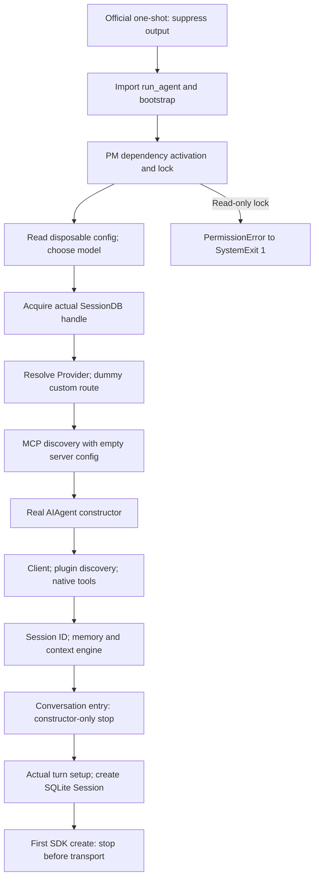

# Phase 8.3A: real Hermes initialization, zero Provider requests

Executed 2026-10-23 through 2026-10-24 (Asia/Shanghai).

**Offline diagnostic acceptance: PASS, 12/12 exact case verdicts.**
Actual `run_oneshot`, `_run_agent` and `AIAgent` construction executed.
No real Provider credentials, model completion, native tool task or Retry
Shadow acceptance is claimed. **H4D real-provider test: NO-GO.**

## What explains the absent H4C Session?

The original H4C evidence only establishes `SystemExit(1)`, zero persistent
native Session and zero Provider requests. Its hidden exception cannot be
uniquely reconstructed from that record. The available original result pins
the benchmark commit, but contains no upstream Hermes source revision.
Reports referring to v0.22.1 cannot substitute for an execution-time hash.

This investigation independently reproduced a precise compatible failure
on the currently installed, clean Hermes v0.22.4 source:

1. `oneshot._run_agent` imports `run_agent` before loading configuration or
   opening its SessionDB (`hermes_cli/oneshot.py:517-525`).
2. `run_agent` imports `hermes_bootstrap` (`run_agent.py:9-11`).
3. Dependency activation enters `runtime_lock`, which opens the PM
   `.install.lock` with `O_CREAT | O_RDWR`
   (`hermes_cli/runtime_state.py:40-49`, `pm/environments.py:461-467`).
4. In the **synthetic read-only PM-lock case**, actual Seatbelt enforcement
   raises `PermissionError(EPERM)`. The real bootstrap converts it to
   `SystemExit(1)` (`hermes_bootstrap.py:613-617`).
5. Official one-shot discards redirected diagnostics and rethrows the exit
   (`hermes_cli/oneshot.py:287-318`). No Agent construction or SessionDB
   acquisition was reached. The original exception locations remain in the
   new diagnostic event stream without logging values or credentials.

There is a concrete compatibility issue in the old integration shape:
`HERMES_HOME` underneath the user's default `.hermes` root still resolves PM
dependency state to that shared root (`hermes_constants.py:93-101`). The
frozen H4C policy permits reads there but no PM lock writes. A stat-only
inspection confirmed that the current installation has this PM state and
lock. The new diagnostic uses a genuinely separate disposable HOME/root;
it never grants production PM writes or changes the old sandbox.

**Evidence boundary:** the synthetic PM case proves this failure mechanism
and its missing-Session consequence. It does **not** prove that it was the
unique historical cause of H4C. Provider absence separately produced
`AuthError`, not `SystemExit(1)`, in the empty-credential case. Credentials,
MCP, plugins and Provider services must not be blamed from the historical
exit code alone.

## Actual initialization stages and side effects



Constructor completion is not Session creation. Hermes creates the new row
in `_ensure_db_session` (`run_agent.py:315-348`), called from turn setup
(`agent/turn_context.py:1019-1032`). Constructor-only cases had zero rows;
the separate request-preparation case had exactly one actual row.

Configuration, local logging, plugin cache discovery, SessionDB setup,
session directories and memory/context setup can write local state. Route
and model metadata initialization may attempt network access even before
the first model request. The matrix recorded blocked DNS, local socket bind
and environment-probe subprocess attempts; their arguments were not logged.
Every native child had kernel-level zero-network enforcement, including
loopback. No server or synthetic HTTP endpoint was started.

The plugin discovery framework and native `read_file` toolset ran against a
clean profile. Production plugins/MCP configurations were not imported.
The System One plugin's real Shadow/Retry behavior is outside this matrix.

## Frozen versions and provenance

| Item | Revision / digest |
|---|---|
| Handoff baseline and remote PR head | `3057ab231b955a99529fb63c45e41e5a4746b607` |
| Original H4C execution | `8776de71a88821dffd84bfd4976927fd0cfe9c3a` |
| Diagnostic preregistration | `08e2c82` |
| Executed 12-case diagnostic code | `161a09b352c5ab806d16f93fd935fa597f185227` |
| Clean installed / exported Hermes | `4d04303818b61bf3aa09278af48356315515965b` (`v0.22.4`) |
| Complete Git source archive SHA-256 | `80b083e924d72e6e2203c977992dc521b7ad2040593d0cf53ac52dac0c457b09` |

The exported snapshot contains only committed public source. The installed
Python libraries were reused read-only; no dependency installation, global
Python change or production source modification occurred. Available Work
execution was the local Mac; cloud GitHub tools were used for PR inspection.

The [public aggregate](../results/processed/phase8_3_init_diagnostic.json)
records source/runner/child hashes, case boundaries and exact outcomes.
After execution, the verifier was tightened to also reject timeout or bad
cleanup following an expected AuthError/PM failure. A **separate process**
re-read all 12 original cases with that stricter verifier; all still passed.
Native child code and the executed evidence were not rewritten.

## Case results

| Case | Actual observed boundary / failure | Persistent rows | Result |
|---|---|---:|---|
| init, init_repeat | Real constructor completed; stop at turn entry | 0 each | PASS, reproducible |
| empty_stepfun | Actual resolver AuthError, no supplied credential | 0 | Expected failure PASS |
| request_boundary | First real SDK create intercepted once; exit 72 | 1 | Pre-transport boundary PASS |
| bootstrap_pm_readonly | OS PermissionError → real SystemExit(1) | No DB | Expected failure PASS |
| bootstrap:exit | Injected SystemExit at bootstrap entry | No DB | Injection PASS |
| provider:exit | Injected SystemExit at resolver entry | 0 | Injection PASS |
| mcp:error | Injected RuntimeError before MCP startup | 0 | Injection PASS |
| constructor:exit | Injected SystemExit at constructor entry | 0 | Injection PASS |
| tools:exit | Injected SystemExit at real tool loading entry | 0 | Injection PASS |
| constructor:crash | Explicit process exit 71 at constructor entry | 0 | Crash/recovery PASS |
| constructor:timeout | Bounded parent timeout; verified child group SIGTERM | 0 | Timeout/recovery PASS |

The SDK sentinel initially raised an exception, which Hermes caught in its
worker and retried three times. That exploratory run was **not accepted as
a first-request stop**. The final child flushes the boundary record and
exits 72 immediately; the parent then archives and restores after reaping.
No model response or successful Agent task is fabricated.

## Isolation, restoration and independent checks

Each case has a preregistration, clean HOME/HERMES_HOME/cache/tmp, an
allowlisted environment and before/post snapshots. Synthetic config uses a
dummy custom key and loopback port 1; no service is listening or allowed to
be contacted. Every native child first proves OS denial of a synthetic
forbidden read/write and raw socket connection. The final policy uses fixed
user-data read grants, not a listing of currently existing files; metadata
reads support the OS loader. Writes stay in that case's mutable scratch and
`/dev/null`. Child process creation is denied.

The parent records PID, PGID, UID and kernel start time before sending the
GO handshake. Timeout termination requires an exact identity match.
Restoration occurs only after the child is reaped and its group is absent.
SQLite backup incorporates committed WAL frames before read-only inspection
of the normalized snapshot. Restored file bytes/modes and the external
synthetic sentinel were independently compared for every case: **12/12**.

The initial Work outer sandbox rejected sandbox application and process
query before native import. A controlled execution grant allowed the
supervisor to apply the required inner Seatbelt; no unsandboxed native run
was used. An initial dependency alias admission issue and a synthetic 32K
context configuration failure were recorded separately, then corrected.
No failed exploratory run was substituted for final matrix evidence.

Original H1–H4C logs, Session stores and recovery snapshots were not copied
or overwritten. The historical ledger SHA-256 was checked before and after:
`5b93ff7c76bcf74f85cf5e955e90b1a425608287c1213b3a3fd5185bee3ab5cb`.
It still accounts for **8/24**, including the original **one H1 UNKNOWN**.
No production Gateway, default profile, authentication material, NAS or
main branch was changed.

## Regression and review

The new diagnostic has **31 focused safety tests**, including exception
redaction, poisoned environment rejection, fixed read scopes, bad final
verdicts, unmatched process identity, unreached injections, SDK retries and
an actual SQLite WAL backup regression.

Full Python coverage: **1388 PASS, 1 SKIP** across the isolated suite and
targeted OS checks. The skip is the explicitly optional original private
H1–H3 ledger fixture, which was deliberately not mounted into this clean
public checkout; its original digest was checked independently. Two real
Seatbelt tests used their own sandbox children (nested sandbox application
is unavailable). Two process-identity tests kept `/bin/ps` in the supervisor
because macOS refuses the setuid binary inside Seatbelt; their only sleep
workloads remained sandboxed. No process validators were weakened.

Three old preflight tests implicitly required an existing private test
directory; they now supply temporary directory fixtures. The missing-auth
unit test also stubs route inspection, so it cannot consult a live auth
file. The native tool registry test accepts an explicit exported source
snapshot through `HERMES_TEST_SOURCE`; the same assertions still execute
against real registry code. This exposes and removes host dependencies
without relaxing preflight checks or copying old private data.

DSH: **64/64 PASS**, TypeScript typecheck and build PASS. No DSH source
changes. Public release sanitizer is required on the final clean commit.

One independent Astra review found the first-SDK retry issue, the initial
read-denial enumeration gap and incomplete terminal-verdict validation.
These were corrected with concrete regression tests; focused reinspection
and stricter independent adjudication used actual files and case evidence.

## H4D decision and reproducibility

**NO-GO for a new real Provider-backed H4D.** New paid requests remain
unauthorized. Technical prerequisites still include a separately frozen
native/adapter profile whose dependency-state ownership and authenticated
route are verified without accessing or writing production state, then the
actual missing-file + Retry Shadow path. The historical H1 UNKNOWN remains
an independent global accounting blocker.

Offline diagnosis may be repeated with a newly exported clean Hermes source,
the official Python interpreter and a never-used output directory:

```sh
python scripts/phase8_3_init_diagnostic.py \
  --source /path/to/exported-hermes \
  --python /path/to/hermes-venv/bin/python \
  --output /path/to/new-disposable-experiment
python scripts/phase8_3_init_diagnostic.py --verify /path/to/experiment/init
```

The commands require macOS Seatbelt. A failed capability/admission check
must remain a block. They grant no real Provider, Active/Canary, production
deployment or main-branch merge authority.

## 2026-10-25 original Work-scope closeout

All eight deliverables in the original Work handoff are complete in their
specified **offline engineering scope**. Real H4D execution was explicitly
outside that handoff's completion conditions.

| Original deliverable | Delivered evidence |
|---|---|
| Real AIAgent stage graph and dependency analysis | Stage graph and import/PM/Provider/Session boundaries above; frozen upstream source |
| Zero-real-Provider diagnostic tool | `scripts/phase8_3_init_diagnostic.py` and `phase8_3_init_child.py` |
| Stage/type evidence | Actual stage events, exception types and source-relative frames; no secret values |
| Initialization/crash/timeout injection | Twelve preserved cases with exact expected verdicts |
| Independent rollback and safety verification | Actual SQLite snapshots, restored bytes/modes, protected sentinels and stopped owned groups |
| Repair proven integration defects | Disposable dependency namespace, safe first-request stop, terminal-verdict checks and admission-receipt cleanup |
| Regression and existing Draft PR update | 1424 Python passes / 1 optional skip; DSH 64/64, typecheck/build; same Draft PR #9 |
| Explicit real-H4D decision | NO-GO; minimum verified failure boundary and remaining real-environment gaps stated |

Closeout found one remaining cleanup gap in the initialization runner:
the initial `process.json` write was outside its cleanup `try`. A disk error
or interruption at that point could leave an owned child waiting for GO.
The write now runs inside the existing protected block. The same identity
checks and `stop_owned` implementation apply; no process permission was
expanded. Two regression cases first failed, then passed for `OSError` and
`KeyboardInterrupt`; both assert no GO, cleanup of the recorded owner and
unchanged scratch baseline. The combined diagnostic/rehearsal suite is now
**67/67**. A bounded independent code review found no blocker in this fix.

Fresh full regression: **1424 PASS, 1 SKIP** (1420 in the isolated main
suite, two kernel and two owned-process checks separately); DSH **64/64**,
TypeScript typecheck/build PASS. The optional historical private-ledger
fixture remains deliberately unmounted; its digest was verified directly.

A new read-only verifier, in a separate process, reread all twelve original
diagnostic cases and all four rehearsal cases with the final verification
code. Actual SQLite, events, HTTP/HMAC correlation, restored trees, process
absence, frozen source/model hashes and old test-log hashes all passed.
The original case results are unchanged. **No native matrix was rerun, no
new model inference occurred, and no real Provider request was made.**
The public aggregate includes the new closeout receipt separately from the
original execution counts and hashes.

This completion does not establish H4C's unique historical cause. Its
original upstream source/hidden exception were not captured; the verified
PM-lock reproduction is the minimum compatible failure boundary requested
by the handoff. It also does not establish stock shell transport, real H4D
E2E, model value or savings. The next distinct phase should qualify the
unmodified file-tool shell dependencies offline before considering a
separately specified real-Provider case.


## 2026-10-26 independent stock-shell qualification and steps 1–3 closeout

The existing Phase 8.3 work was resumed from GitHub Draft PR #9 at
`840ea824d23c2bd980e44035556efc4ad48194f4` using a **new isolated
worktree**. GitHub main remains `062d52e753e7e00d91a536dc81e9d85b8819cb12`,
NAS Forgejo main remains `afa2512cc66400d111c28cb5fe00e9f83fdba49a`,
and the former Phase 8.3 worktree and all original H1–H4C evidence were left
unchanged. An existing NAS-main untracked `uv.lock` was preserved.

A new `off_stock_shell` case tests the previously unverified original
Hermes shell transport, without the prior Python directory-listing bridge.
It retains genuine Hermes Agent/`read_file`/SQLite behavior, tests actual
Bash initialization and native file-error construction, and uses a strictly
synthetic two-response main Provider. Its OS sandbox permits bounded
native shell creation in this new OFF-only experiment but denies external
network and production file access. Original preregistered source commit:
`da998de1601155f7f2bc47185768dea612b0642a`. Frozen execution and a
second independent read-only verifier both returned **PASS_SCOPED**: three
native Bash spawns, five restricted ancillary upstream process probes,
one authenticated missing-file tool result, zero external Provider requests,
zero Shadow observations, fully restored disposable Home/process state.
No original OFF/Shadow/MLX/503 experiment was rerun or relabelled.

Full fresh Python regression: **1429 PASS / 2 SKIP**, plus five separately
executed kernel/owned-process tests **5/5 PASS**. The optional native registry
integration skip was separately recovered using the exported upstream
source and passed; original private Provider-ledger fixture intentionally
remains SKIP. DSH **64/64 PASS**, TypeScript typecheck and build PASS.
See the [dedicated stock-shell report](PHASE8_3_STOCK_SHELL_QUALIFICATION_REPORT.md),
[preregistration](PHASE8_3_STOCK_SHELL_QUALIFICATION.md), and
[privacy-safe aggregate](../results/processed/phase8_3_stock_shell_qualification.json).

The original historic Provider ledger SHA remained unchanged; **8/24**, one
H1 UNKNOWN. **Real H4D/DSH Native Provider E2E NOT RUN; real Laya value
NOT_ESTABLISHED; actual savings NOT_MEASURED; Active NOT_AUTHORIZED.** The
new proof closes only the isolated stock-shell dependency gap. It provides
no permission for paid requests, Active decisions, automatic merging or
production deployment.
