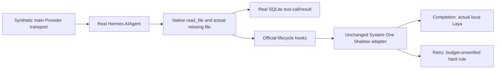

# Offline native missing-file and Shadow rehearsal

2026-10-24. **PASS_SCOPED: four of four cases**, using genuine Hermes
Agent/tool/SQLite/plugin execution with an in-memory synthetic main Provider.
**No real StepFun requests. H4D real execution remains NO-GO.**

## What now works

The real Hermes Agent calls `read_file` once on a preregistered absent text
file. The actual filesystem check and upstream error construction produce
`not_found=true` and `File not found:`. The same tool-call ID appears in the
assistant call, native tool-result row and lifecycle witness. The second
synthetic Provider response is returned only after its request contains that
actual native error; it does not create or replace the tool result.

Official plugin discovery loads the repository's unchanged 0.9.0 adapter in
a fresh Home. Its two Completion observations and one Retry observation
join to the original Session, turn, tool and HTTP decision requests by HMAC.
Wrong endpoints, missing/duplicate records, mismatched IDs, changed response
decisions, bad process exits, failed restoration or absent model evidence
cannot receive PASS.

## Evidence tiers and necessary isolation

**Genuine native components:** official one-shot and Agent, native file stat,
`read_file` handler, missing-file `ReadResult` construction, dispatcher,
lifecycle hooks, SQLite persistence and plugin discovery. No `_run_agent`
stub, synthetic native hook, fabricated database row or fabricated file
error is used in the executed matrix.

**Synthetic main model:** `httpx.MockTransport` supplies precisely one
OpenAI streaming tool-call response and one final response. SDK parsing and
the native loop execute, but the main model does not make a decision.
Fixture token usage is synthetic; it is not billing evidence. An invalid
request ends the disposable child immediately, preventing Hermes from
retrying a broken fixture contract.

**Two isolated shell dependencies:** the frozen Hermes missing-file branch
uses shell `ls` for Unicode filename matching and similar-file suggestions,
even though its initial missing-file check uses native `os.stat`. The first
OFF attempts correctly failed when these subprocesses were denied. The
final child disables the shell environment snapshot and implements only
those two exact target-parent directory queries with real standard-library
directory enumeration. Every other command/path is rejected; all subprocess
creation remains denied. Upstream error construction still executes.
This is **dependency-isolated native evidence**, not stock shell transport
acceptance. The helper never returns a hardcoded `ReadResult`.

The frozen Hermes revision leaves the tool-result `tool_name` column null;
the validator accepts only null or `read_file`, then independently requires
the paired assistant function and real hook to identify `read_file`.
Adding the standard usage-ending SSE frame made the fixture exercise native
route accounting too. This is a protocol correction, not altered native
evidence. Exploratory cases with incomplete evidence remain BLOCKED.

## Final cases

| Case | Native reads / main fixture responses | Adapter / HTTP observations | Actual local inference | Result |
|---|---:|---:|---|---|
| OFF | 1 / 2 | 0 / 0 | None | PASS_SCOPED |
| Shadow, fixture runtime | 1 / 2 | 3 / 3 | Synthetic answers only | PASS_SCOPED |
| Shadow, pinned MLX | 1 / 2 | 3 / 3 | 2 Completion predictions | PASS_SCOPED |
| Shadow, owned service returns 503 | 1 / 2 | 3 / 3 | None; all observations fail open | PASS_SCOPED |

In each case the actual native database has one Session and the expected
user → assistant tool call → tool error → final assistant sequence. There
is no extra file tool, actual retry or model switch. Healthy Shadow joins
verify request IDs, endpoint, workflow and consumed decision/source/backend;
503 joins verify the actual failed-open records and unchanged native result.

Retry returns `ask_user` through `retry_budget_unverified`. It makes **zero**
model predictions because the native hook supplies no verified retry budget.
Those restrictions were preserved. The case demonstrates that its Retry
decision is covered by a rule; it does not establish a model benefit.

The fixture runtime occupies the engine's generic MLX slot for contract
testing, so its engine metric can say `mlx`; its explicit `runtime_kind`
marks it synthetic and it contributes **zero real MLX predictions**.
The actual MLX case additionally checks the implementation class and
successful `MLXRuntime.predict` counters. Metrics alone are not sufficient.

## Local Laya admission

Pinned model revision: `f9ab0b228f0fc0f14d873dbc99038f135c2da1b2`.
Weights SHA-256:
`4fa56de72383a9d3efa9cfa78955733c81b9fc8067a587ca4beb82c78107a24e`.
The cache uses a shared blob alias; its resolved bytes match this digest.
Only the individual model files and their resolved blob targets are readable,
not the entire Hugging Face cache. No model download or credential lookup.

The first MLX attempt loaded the weights but did not finish its first
prediction within the adapter's unchanged five-second timeout; Completion
failed open and that case was BLOCKED. A separately preregistered, bounded
three-choice warmup now must finish before Hermes is admitted. The final
case has **one synthetic warmup prediction plus two genuine Completion
predictions from native hook inputs**. Warmup does not count as native task
evidence. No adapter timeout increase or GPU sandbox relaxation was used to
obtain this result.

Observed runtime: Python 3.12.14, mlx 0.32.2, laya-mlx 0.2.0. The package
warns about clamped checkpoint temperatures in affected larger-choice
buckets; this experiment makes no confidence-calibration or accuracy claim.
A Metal sandbox-extension warning remained nonfatal after admission. It
must not be presented as the proven cause of the earlier timeout.

## Versions and independent restoration

| Input | Binding |
|---|---|
| Task baseline | `a947c4b296dfc1dd0a00f2fcd80a33c7114d00f0` |
| Preregistered implementation | `97a1b46` |
| Executed final four-case matrix | `dc6b9c0046ac4ff40710bb5d83c110ae3f8257e4` |
| Executed public Hermes export | `4d04303818b61bf3aa09278af48356315515965b` |
| Installed checkout observed, not executed | `bf0203a794a07aac3ff764972ab9087baa4e4f4e` |

Source, adapter, runner and model-file hashes were recorded before the
matrix. The independent verifier rechecked the executed Git objects and
actual model bytes, then re-read SQLite, hook/HTTP records and restored
files. The [public aggregate](../results/processed/phase8_3_offline_native_rehearsal.json)
contains bounded results and evidence hashes, not raw identifiers or keys.

Each case has its own HOME, dependency-state namespace, cache/tmp and before
and post snapshots. Native processes may connect only to their owned local
Shadow port; external network is denied. Runtime processes may bind only
their assigned loopback port. MLX has named GPU/Metal capabilities and
read-only model/dependency access. There is no production configuration or
authentication access and no global Python/package mutation.

All **7/7** final-matrix process groups stopped, verified against recorded
ownership. SQLite backup includes committed WAL before the Home is restored.
All four native Homes, runtime scratch trees and protected sentinels were
independently checked after restoration. Raw synthetic evidence is retained
outside the public repository.

The final code also closes an admission failure gap discovered by review:
cleanup ownership is now registered before writing the process receipt and
sending GO. A receipt-write failure cannot leave an unregistered child.
This final failure-path repair has a dedicated regression; the unchanged
matrix evidence was separately re-adjudicated with the final verifier.

## Validation and boundaries

- New rehearsal suite: **34 tests**, including native-SQLite counterexamples,
  wrong HMAC/endpoint/response, missing events/metrics, fake MLX evidence,
  503 fail-open, cleanup continuation, failed admission-receipt writes and
  model symlinks escaping their bounded cache.
- Full Python coverage: **1422 PASS, 1 SKIP**. Main sandbox: 1418 passes;
  two kernel Seatbelt tests and two supervisor process-identity tests pass
  separately. The optional original-private-ledger fixture is not mounted;
  its original digest is independently checked instead.
- DSH Vitest **64/64 PASS**; TypeScript typecheck and build PASS.
- An independent Astra review examined actual code and evidence. Its cleanup,
  terminal status, HTTP identity and actual-inference findings were repaired
  and covered by negative tests. No automatic full-review loop or merge.
- Public release sanitizer must pass on the final clean publishing commit.

New physical StepFun requests: **0**. Original ledger unchanged:
`5b93ff7c76bcf74f85cf5e955e90b1a425608287c1213b3a3fd5185bee3ab5cb`.
Historical **8/24** and **one H1 UNKNOWN** remain intact. No production
Gateway restart, authenticated Home mutation, H1–H4C evidence overwrite,
NAS change, main-branch merge or Active/Canary action occurred.

## H4D decision and remaining authorization

**Offline prerequisite: PASS_SCOPED. Real H4D execution: NO-GO.**
This work removes the initialization and native-event-correlation blind
spots. It does not prove a real main model's missing-file behavior, Agent
value, savings or production reliability, and does not resolve H4C's unique
historical cause.

Before a genuine Provider-backed case:

1. Freeze the exact Hermes source and interpreter; either retain the tested
   export or separately requalify a different revision. Do not silently use
   the now-newer production checkout.
2. Explicitly qualify the intended file-tool dependency boundary. Stock
   shell transport is still unvalidated; do not call this narrow bridge an
   unchanged full native environment or broadly enable shell access.
3. Define a fresh isolated authentication flow and capped StepFun route,
   without copying or reading production/old test credentials. Preparing
   this document does not authorize login, credential consumption or egress.
4. Obtain explicit authorization for the separately preregistered real
   case: at most three physical requests, original 24-request cumulative
   cap and one-shot time limit, no automatic retry. Keep H1 UNKNOWN; do not
   erase it to claim globally reconciled accounting.

The Draft PR may be reviewed in this offline scope. It remains unmerged.
